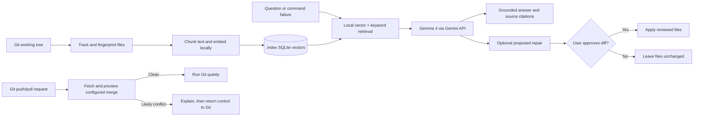

# Codemate

**A retrieval-augmented coding assistant powered by Gemma 4, an open-weight AI model.**

Codemate uses **RAG (retrieval-augmented generation)** to find relevant code in a
local repository index before asking Gemma 4 to answer questions or diagnose
command failures. It cites the source files behind its answers, remembers
recurring failures, checks for likely Git push/pull conflicts, and can propose
code repairs for the developer to review and approve.

The default Gemma 4 model is an open-weight model accessed through Google's
Gemini API; inference is hosted, not run locally. Repository tracking,
embeddings, and retrieval run locally, and Codemate sends selected code
excerpts and relevant prompts to the configured chat provider.

> **Hacktoberfest 2026 · Best Use of Gemma** — Codemate puts Gemma 4 at the
> answer and diagnosis stage of a local RAG workflow, grounded in retrieved
> repository code rather than a prompt alone.
> See the [Hacktoberfest 2026 challenge hub](https://dev.to/challenges/hf26).

## Why Codemate?

Most coding assistants start with a prompt. Codemate starts with the repository
and the failure that actually happened. Its local index gives the model relevant
code excerpts and line references; its Failure Atlas adds context when the same
problem returns.

| What makes it different | How it works |
| --- | --- |
| **Repository-grounded answers** | Combines local vector search with keyword matching and cites the retrieved files and line ranges. |
| **A memory for failures** | Groups repeated command failures in a local Failure Atlas and asks the model to re-check prior diagnoses against current evidence. |
| **A repair loop with human control** | The agent can search and read repository files, then prepare a diff. Codemate asks before applying it and can re-diagnose repeated failures. |
| **Safer Git integration** | Previews configured push/pull merge conflicts before running Git; clean checks stay quiet, while likely conflicts get an explanation. |
| **Local-first retrieval** | Repository tracking, chunking, embeddings, and retrieval happen locally. Only selected excerpts and the relevant question or error output are sent to the configured chat provider. |

Codemate is designed to help developers understand and fix problems—not to
silently change a codebase. The repair agent has no shell tool, displays the
complete proposed diff, and requires approval before writing files.

## Quick start

**Requirements:** Python 3.10 or newer, Git, and a Gemini API key for the
default Gemma 4 setup.

Install the current source from GitHub with `pipx` (recommended for command-line
apps; it creates an isolated environment):

```sh
pipx install 'codemate[embeddings] @ git+https://github.com/PruthviRajG25/MLH-HACKDAY.git'
codemate init
codemate index
codemate ask "How is this project structured?"
```

For development from a local clone instead:

```sh
python -m pip install -e '.[embeddings]'
codemate init
codemate index
codemate ask "How is this project structured?"
```

`codemate init` configures the chat provider, model, endpoint, and API key. The
API key prompt is hidden, and credentials are saved in your user configuration
directory—not in the repository. The default model is `gemma-4-26b-a4b-it` on
Google's Gemini API. The first `codemate index` run downloads the local
embedding model if it is not cached; expect that first run to take longer.

To inventory the current Git working tree without creating embeddings, run:

```sh
codemate track
```

## What Codemate does

### Ask questions about a codebase

```sh
codemate ask "Where is authentication handled?"
codemate ask "How does the index update changed files?" --top-k 8
```

Codemate embeds the question locally, retrieves relevant chunks, and sends the
question and those excerpts to the configured chat model. Answers cite source
paths and line ranges. The terminal renderer formats common Markdown for CLI
output.

### Diagnose a failing command

```sh
codemate run pytest -q
codemate run -- npm test
```

Codemate runs the command and preserves its exit status. On failure, it refreshes
an existing index, retrieves relevant code, and asks the model to explain the
error. In an interactive terminal, you can save a Markdown report under
`report/` or ask the repair agent to propose a code change. If an approved repair
does not fix the command, Codemate can refresh the index and repeat the analysis
and review cycle.

Commands are executed directly, without a shell. For shell syntax, pass a shell
explicitly, for example `codemate run sh -c 'make check'`.

### Check Git push and pull operations

```sh
codemate git push
codemate git pull
```

Before these operations, Codemate fetches the configured remote and previews
whether the configured push target or upstream is likely to conflict. If the
preview is clean, Codemate stays quiet and runs Git. If it finds likely
conflicts, Codemate identifies the affected paths and offers a
repository-grounded explanation before handing control to Git. If a pull then
fails with merge conflicts, Codemate can diagnose the failure and offer an
approval-gated repair proposal. It does not stage, commit, or automatically
rerun Git after a repair.

Extra Git arguments are forwarded to Git without preflight because Codemate
cannot safely infer a custom target. Preflight fetch updates the usual
remote-tracking metadata. Git's merge preview can add objects to the local
object database, but does not change the working tree, index, or current commit.
A push cannot merge remote changes; if the remote is ahead, Git may reject the
push until the history is integrated.

### Review recurring failures

```sh
codemate failures
codemate failures --all
```

The local Failure Atlas stores failure signatures, occurrence counts, the last
seen commit, diagnoses, and report paths in `.index/failures.sqlite3`. It stays
on your machine with the rest of the index.

## How it works



The tracker uses Git to discover tracked and non-ignored untracked files, then
fingerprints their current working-tree contents in `.index/manifest.json`.
The indexer chunks supported text files, creates embeddings locally with
`BAAI/bge-small-en-v1.5`, and stores chunks, vectors, and source locations in
`.index/vectors.sqlite3`. Only changed files need to be embedded again.

## Gemma 4 and model configuration

Gemma 4 is the default chat model and powers Codemate's repository Q&A,
diagnostics, conflict explanations, and repair-agent reasoning. The default
configuration uses the Gemini API; **model inference is not local**. Local
tracking, embeddings, retrieval, and failure history stay on the machine.

```sh
codemate config list
codemate config set model gemma-4-31b-it
codemate config set api-key
codemate config unset api-key
```

`codemate init` can also reconfigure the provider interactively. Codemate
supports Gemini and OpenAI-compatible chat endpoints. API keys are hidden when
entered and saved with private file permissions. Do not put secrets in command
arguments or diagnostic output.

When you ask a question or diagnose a failure, Codemate sends the relevant
prompt and retrieved code excerpts to the configured chat provider. For a
failed command, that can include the captured command output. Review sensitive
logs before sending them to any hosted model.

## Commands

| Command | Purpose |
| --- | --- |
| `codemate init` | Configure provider, model, endpoint, and API key. |
| `codemate config list` | Show saved settings without revealing the API key. |
| `codemate config set model MODEL` | Change the saved chat model. |
| `codemate config set api-key` | Set or rotate the key using a hidden prompt. |
| `codemate config unset FIELD` | Remove a saved setting. |
| `codemate track` | Update the Git-aware file inventory. |
| `codemate index` | Refresh the local chunk and vector index. |
| `codemate ask "question" [--top-k N]` | Ask a repository question with cited evidence. |
| `codemate run COMMAND [ARGS...]` | Run a command and diagnose failures. |
| `codemate git push [GIT-ARGS...]` | Check for likely conflicts, then run Git push. |
| `codemate git pull [GIT-ARGS...]` | Check for likely conflicts, then run Git pull. |
| `codemate failures` | View active incidents in the local Failure Atlas. |
| `codemate failures --all` | Include resolved incidents. |
| `codemate doctor` | Check configuration, API access, and local index status. |
| `codemate evaluate` | Measure retrieval quality against expected source files. |

Use `--repo /path/to/repository` on supported commands to target another
repository. Run `codemate --help` or `codemate <command> --help` for options.

## Retrieval evaluation

Codemate includes a starter evaluation set in `.codemate-eval.json`. Each case
contains a question and the source files expected to answer it.

```sh
codemate evaluate
codemate evaluate --file path/to/cases.json --top-k 8
```

The command reports Recall@k and mean reciprocal rank (MRR@k).

## Contributing

Issues, reproducible bug reports, and focused pull requests are welcome. A good
contribution can improve code, documentation, retrieval quality, or the safety
and clarity of the diagnostic workflow. Before opening a pull request, describe
the user problem it addresses and include the commands or observations used to
verify it. Never include API keys, private source code, or unredacted logs in an
issue or report.

For a local development install, use the Quick Start commands above. The
repository's `.index/`, `report/`, virtual environments, caches, and secrets are
excluded by `.gitignore`; tests and evaluation data are not ignored.

## Install on another computer

Codemate is a Python command-line application. A user needs Python 3.10 or
newer, Git, and a supported operating system. The GitHub install command above
works on macOS, Linux, and Windows when Python, Git, `pipx`, and the project's
dependencies are available. Run `codemate init` once on each computer to save
that user's provider settings, then run `codemate index` inside a repository.
Each repository gets its own local `.index/`; that index is not distributed
with the CLI package.

### Windows PowerShell

Follow these steps in order. You install Codemate once; after that, you can run
it from any Git repository on this computer.

#### 1. Install the prerequisites

Install [Python 3.11 or newer](https://www.python.org/downloads/windows/) and
[Git for Windows](https://git-scm.com/download/win). In the Python installer,
enable **Add Python to PATH**. Git is needed both to download Codemate and for
Codemate to inspect projects.

Open a new PowerShell window and check that both commands work:

```powershell
py --version
git --version
```

#### 2. Install `pipx`

`pipx` installs command-line apps into their own environment, separate from
other Python projects. Install it and add its command directory to your PATH:

```powershell
py -m pip install --user pipx
py -m pipx ensurepath
```

Close and reopen PowerShell so the PATH update takes effect. Verify `pipx` is
available:

```powershell
pipx --version
```

#### 3. Download and install Codemate from GitHub

Run this command in PowerShell:

```powershell
pipx install "codemate[embeddings] @ git+https://github.com/PruthviRajG25/MLH-HACKDAY.git"
```

`pipx` uses Git to fetch the repository, installs Codemate and its embedding
dependency into an isolated environment, and makes the `codemate` command
available in your PATH. No PyPI account or upload is involved. Confirm the
installation:

```powershell
codemate --help
```

#### 4. Configure the AI provider once

Run:

```powershell
codemate init
```

Follow the prompts for provider, model, endpoint, and API key. With the default
Gemini provider, Codemate uses Gemma 4. The API key prompt is hidden, and the
settings are saved in your Windows user configuration—not in the project
folder. You only need to do this once per Windows user account.

#### 5. Open the project you want Codemate to understand

Use `Set-Location` to move into the developer's own project folder. The folder
must be a Git repository:

```powershell
Set-Location "C:\path\to\your\project"
git status
```

Replace the example path with the actual folder. `git status` should show the
repository's branch and working-tree state.

#### 6. Build the project's local index

Run this from inside the project folder:

```powershell
codemate index
```

Codemate discovers the repository files, chunks readable source text, creates
embeddings on the computer, and saves the index in that project's `.index/`
folder. The first run downloads the embedding model and may take longer. Each
project has its own index; installing Codemate does not copy or upload project
files.

Codemate can index readable source files from any programming language; it does
not compile the project or require a language-specific plugin. Binary files,
non-text files, and files over the configured size limit are skipped.

#### 7. Ask questions or run commands

Still in the project folder, ask a question:

```powershell
codemate ask "Where is the application entry point?"
```

You can also run normal repository commands through Codemate for failure
diagnosis:

```powershell
codemate run pytest -q
```

See the [command reference](#commands) for the other commands. Run
`codemate index` again after changing the project so new and changed files are
searchable.

#### 8. Update Codemate later

When a newer version has been pushed to the GitHub repository, update your
installation with:

```powershell
pipx upgrade codemate
```

To install from a ZIP instead, use GitHub's **Code → Download ZIP**, extract
the archive, and open PowerShell in the extracted project folder. This
alternative installs Codemate into a virtual environment inside the extracted
folder instead of making a PATH-wide command:

```powershell
py -m venv .venv
.\.venv\Scripts\python.exe -m pip install ".[embeddings]"
.\.venv\Scripts\codemate.exe init
```

Run `.\.venv\Scripts\codemate.exe` from that environment. Git still needs to
be installed separately because Codemate uses Git to inspect repositories.

After a PyPI release, the installation command can be simplified to:

```sh
pipx install 'UNIQUE-PYPI-DISTRIBUTION-NAME[embeddings]'
```

The PyPI distribution name `codemate` is already used by an unrelated project.
Before publishing, choose an available name, update `project.name` in
`pyproject.toml`, and replace `UNIQUE-PYPI-DISTRIBUTION-NAME` above with that
name. The installed command can remain `codemate` through the
`[project.scripts]` entry point.

## Build and publish a release

Python projects are packaged as a wheel and source archive rather than compiled
into one binary for every device. The wheel for Codemate's Python code can be
used across compatible platforms; dependencies such as `fastembed` still need
to support the user's operating system and Python version.

From the repository root, set a new version in `pyproject.toml`, then build and
check the release files:

```sh
python -m pip install --upgrade build twine
python -m build
python -m twine check dist/*
```

This creates a wheel and source distribution in `dist/`. After choosing a
unique PyPI name, configuring the PyPI project and account, and reviewing the
artifacts, publish them with:

```sh
python -m twine upload dist/*
```

Once uploaded, users can install it with `pipx install
'UNIQUE-PYPI-DISTRIBUTION-NAME[embeddings]'` and upgrade it later with
`pipx upgrade UNIQUE-PYPI-DISTRIBUTION-NAME`. Keep the PyPI upload token private;
Twine prompts for credentials, and PyPI trusted publishing can be configured
for automated releases.

## License

Codemate is licensed under the [MIT License](LICENSE). You may use, modify,
redistribute, and sell copies under its terms; include the copyright and
permission notice with copies or substantial portions of the software.
